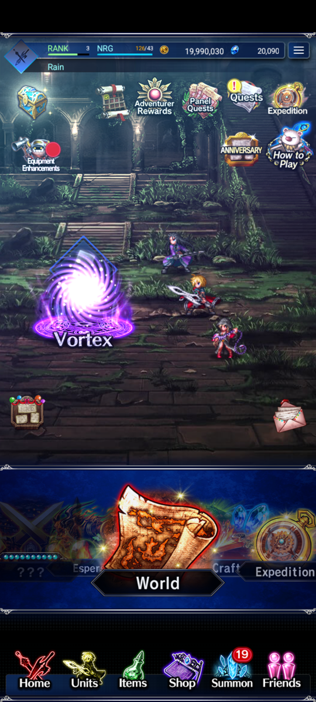
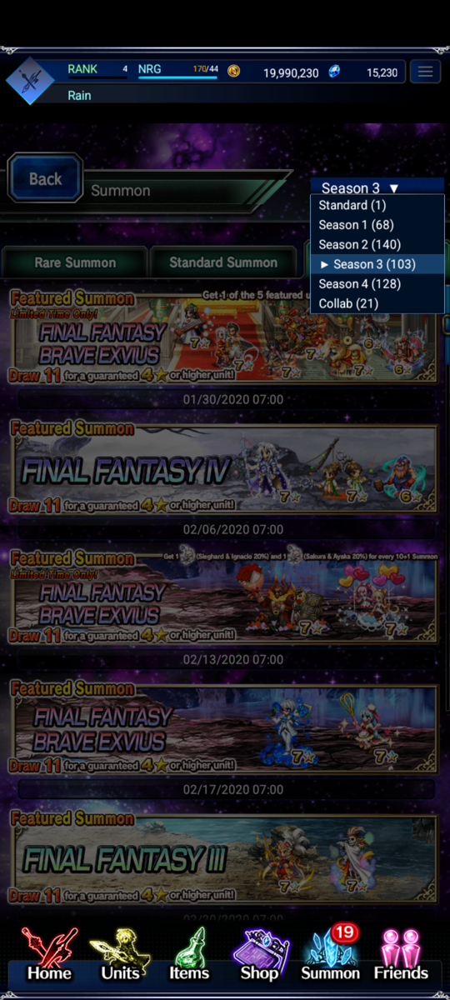
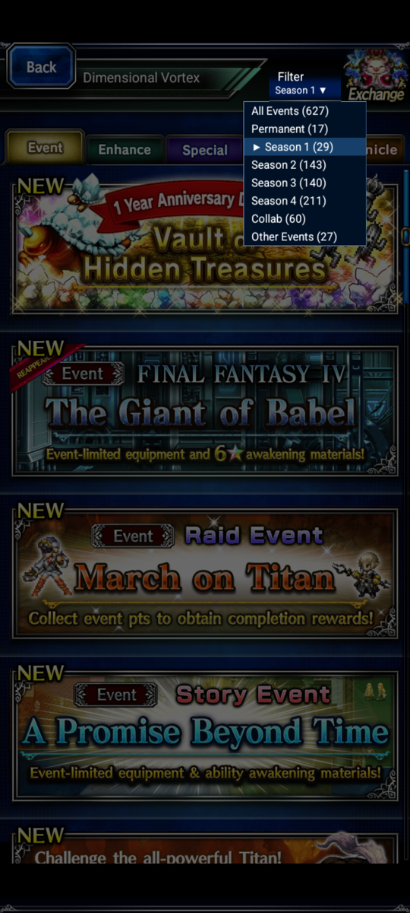

# Exvius 2.0

**A quality-of-life fork of [Elvlin's Exvius Offline](https://github.com/Elvlin/exvius-offline), which plays Final Fantasy Brave Exvius offline on Android.**

Everything below is built on Elvlin's work. This fork adds faster play, better summon odds, more ways to spend lapis and currencies, and fixes for a few things that were broken or hidden. It builds as a separate app called **Exvius 2.0**, so it installs next to the original Exvius Offline instead of replacing it.

**It's built on the older game engine.** Since v0.1.25, Elvlin's published app runs a newer engine whose source isn't public. This fork builds the older engine that is in the repository, plus the changes below, so it doesn't include Elvlin's fixes from v0.1.25 to v0.1.31.

The changes live on the [`qol` branch](https://github.com/HomoYouDidnt/exvius-offline/tree/qol). **None of them have been tested on a phone yet.** There is no download here: you build the app yourself (see [Build and install](#build-and-install)).

This is an unofficial fan project and is not affiliated with Square Enix, gumi or the original author.

## What this fork adds

### Settings you can change

A second launcher icon, **Exvius 2.0 Settings**, holds these. They apply without a rebuild.

- **Game speed:** 1x, 1.5x, 2x or 3x for the whole game, not only battles.
- **5★ and Neo Vision chance:** 1x, 2x, 5x or 10x.
- **Rate-up units on top of that:** 1x, 2x or 4x. The in-game **Drop Rates** button shows the real odds.
- **Lapis gained:** 1x, 2x, 3x, 5x or 10x on every lapis reward. Spending isn't multiplied.
- **Lapis summon price:** Normal, Half, or 1 lapis for any lapis summon.
- **Unit Shop price:** 1 gil or free.
- **Save export and import:** copy your save to a file and back. The app also keeps 5 automatic backups, made each time it opens.

[SUMMON_RATES.md](SUMMON_RATES.md) explains how a pull works and where the numbers come from.

### New shops

- **Unit Shop:** every summonable unit that has an icon in the game data, 1,209 of them, for 1 gil each or free. They're split into tabs by rarity and name (NV, 5★, 4★ and 1-3★).
- **Gil instead of lapis:** bundles and the coin exchange shops (VIP, EX Coin, Daily Coin and the Unit Shop) cost gil, at the same number they used to cost in lapis.
- **Super Trust Moogle exchange:** spend Super Trust Moogle Exchange Tickets on a 100% STMR moogle.
- **Moogle Shop:** 100% Trust Moogles and 100% Super Trust Moogles for 300 gil each, no buy limit, with the other coin shops.
- **Dead currencies:** the United Forces, Kingdom Hearts and premium coin exchanges are open again, using the game's own shop tables. Kingdom Hearts banners take their coins on 11-summons.

### Gameplay

- **Random battles in explorations** are back, in 263 of the 473 explorations. The rest have no enemy data to draw on.
- **Each party keeps its own equipment.** Switching parties swaps gear, so you don't have to re-equip units shared between parties.
- **The present inbox is reachable again.** Its envelope button was hidden under the Home carousel and couldn't be tapped; it now sits above it.

### Speed and fixes

- **Less lag on the summon screen.** It used to re-read about 15 MB of banner files on every visit and tap. Those files are now read once, and saves are about 18 times faster.
- **Less work every frame (off for now).** Native versions of the per-frame animation and banner-scroll hooks are in the code, but they crashed at startup on a Pixel 7 (Android 17), so the original hooks run instead until that's fixed.
- **Smaller summon seasons.** Seasons 2, 3 and 4 are each split in two by release year (for example "S2 2017-18" and "S2 2019-20"), so their lists are shorter.
- **Tall screens:** the town fast-travel list no longer runs under its bottom bar.
- **Update check:** the update file is fetched directly with retries, and failures show a clear message.

## Build and install

You need the original **FFBE Global v9.0.0 APK**, your own signing key and a Windows PC with the Android build tools. [PERSONAL_BUILD.md](PERSONAL_BUILD.md) has every step, including how to copy your save over from the original app with a USB cable.

In short:

1. Build `exvius-2.0.apk` with `source/exvius/build_personal.ps1`.
2. Install it on an **Android 7.0 or newer phone with 64-bit ARM support**. The original Exvius Offline can stay installed.
3. Open it online once. It downloads the game data, about **17.8 GB**, so allow about **21 GB** of free space.
4. Import your save in **Exvius 2.0 Settings** if you copied one over.

A save copied from the original app should load, because the original's newer engine writes the same save fields, but that hasn't been tried yet. The original app keeps its own save either way.

Please don't upload a built APK to this repository. It contains the original game, and this fork is public.

## About the original project

Elvlin's Exvius Offline is built from the original Global game. You download the game data once and then play offline. You can get the published app from [Elvlin's releases](https://github.com/Elvlin/exvius-offline/releases), and report problems with it on [Elvlin's issue tracker](https://github.com/Elvlin/exvius-offline/issues).

If you'd like to support the original author, Elvlin is on [Ko-fi](https://ko-fi.com/elvlin) and [Patreon](https://www.patreon.com/c/ElvlinGame).

Updated November 13: the v0.1.31 download includes the battle music repair, missing summon artwork correction and compatible game-data startup fix. Existing installations receive the music repair through the game-data update.

## Screenshots

| Home | Choose a summon season | Choose an event season |
| :---: | :---: | :---: |
|  |  |  |

## What the original project changed from the online game

### You can farm Lapis by replaying stages.

Quest objectives that award Lapis can pay out again when you replay the stage and meet those objectives again. For example, if a quest gives Lapis for clearing it without using an item, you can earn that Lapis again on another successful run.

Other first-clear rewards, such as equipment, units and tickets, stay one-time. Normal battle drops still work as usual. This gives you a way to keep earning Lapis for summons without a cash shop.

### You choose which summon banners you want.

The dropdown at the top of **Summon** lets you pick **Standard, Season 1, Season 2, Season 3, Season 4 or Collab**. Choose a group, then use the Rare Summon, Standard Summon and Limited Time tabs to find its banners.

Seasons group banners by when they came out. Collab groups crossover banners by series.

Banner prices, featured units, tickets, step-ups and guarantees are kept where their original details are known. Some missing campaign details use replacements. You can check the current pool and rates through the banner's **Drop Rates** button.

### Events are always available

Open **Vortex** and use **Filter** to choose **All Events, Permanent, Season 1, Season 2, Season 3, Season 4, Collab or Other Events**. 
The summon dropdown and Vortex filter are separate. You can browse one season's summons and another season's events on the same save.

### Raids are adjusted for solo play

The shared raid progress is adjusted for one player. The original bosses, battle stats and personal point reward targets are kept; this change is to the shared progress, rather than a blanket reduction in enemy difficulty.

### Former cash bundles cost Lapis

Bundles that used to cost real money are bought with Lapis. There is also a **2,000 Friend Points** bundle for **100 Lapis**. (In Exvius 2.0 these cost gil instead; see above.)

Daily login rewards use your local save and date.

## Files in this repository

- [source/](source/): the code and build scripts.
- [release/](release/): the original project's APK, screenshots and release notes.
- [data/](data/): information about the downloadable game data.
- [PERSONAL_BUILD.md](PERSONAL_BUILD.md): how to build and install Exvius 2.0.
- [SUMMON_RATES.md](SUMMON_RATES.md): how summons work and how to change the rates.

## Credits

Exvius Offline was made by [Elvlin](https://github.com/Elvlin). This fork's changes are by HomoYouDidnt.

Final Fantasy Brave Exvius and its original characters, artwork, music and other game content belong to their respective owners, including Square Enix and gumi. This is an unofficial fan project.
